# 1. Les évolutions

Chaque évolution est décrite par son **résultat attendu**, les **couches** qu'elle touche et quelques **pistes**. Il n'y a pas de solution : c'est à vous de chercher.

Les captures d'écran sont données **à titre indicatif** : elles montrent une réalisation possible, pas un modèle à reproduire. Libre à vous de faire autrement.

Le nombre d'étoiles indique la difficulté. Vous choisissez librement, avec une seule règle : **au moins une** de vos évolutions doit porter le symbole 🧱. Ce sont celles qui font voyager une donnée de la couche données jusqu'à l'interface.

| Évolution | Difficulté | Couches | | Choisis |
|---|---|---|---|---|
| [1. Le plus haut et le plus bas sur 24h](#1-le-plus-haut-et-le-plus-bas-sur-24h) | ⭐ | API, repository, modèle, interface | 🧱 | ✅ |
| [2. Trier la liste](#2-trier-la-liste) | ⭐ | ViewModel, interface |  | ✅ |
| [3. Rechercher une crypto](#3-rechercher-une-crypto) | ⭐ | ViewModel, interface |  | ✅ |
| [4. Suivre d'autres cryptos](#4-suivre-dautres-cryptos) | ⭐ | Repository |  |  |
| [5. Choisir le thème clair ou sombre](#5-choisir-le-thème-clair-ou-sombre) | ⭐ | Interface |  |  |
| [6. Créer votre propre thème](#6-créer-votre-propre-thème) | ⭐ | Interface (thème) |  |  |
| [7. Afficher les logos](#7-afficher-les-logos) | ⭐⭐ | Bibliothèques, modèle, interface |  | ✅ |
| [8. Un squelette de chargement](#8-un-squelette-de-chargement) | ⭐⭐ | Interface |  |  |
| [9. Faire clignoter le prix qui change](#9-faire-clignoter-le-prix-qui-change) | ⭐⭐ | Interface |  |  |
| [10. Rafraîchir en tirant la liste](#10-rafraîchir-en-tirant-la-liste) | ⭐⭐ | ViewModel, état, interface |  |  |
| [11. Rafraîchir automatiquement](#11-rafraîchir-automatiquement) | ⭐⭐ | ViewModel |  |  |
| [12. Les favoris](#12-les-favoris) | ⭐⭐ | Repository, ViewModel, état, interface | 🧱 |  |
| [13. Un convertisseur](#13-un-convertisseur) | ⭐⭐ | ViewModel, état, interface |  |  |
| [14. Changer de devise](#14-changer-de-devise) | ⭐⭐ | API, repository, ViewModel, interface | 🧱 |  |
| [15. Des messages d'erreur précis](#15-des-messages-derreur-précis) | ⭐⭐ | API, repository, ViewModel, état, interface | 🧱 |  |
| [16. Garder les favoris après fermeture](#16-garder-les-favoris-après-fermeture) | ⭐⭐⭐ | Bibliothèques, repository |  |  |
| [17. Le graphique du prix](#17-le-graphique-du-prix) | ⭐⭐⭐ | API, repository, modèle, ViewModel, interface | 🧱 |  |
| [18. Tester le ViewModel](#18-tester-le-viewmodel) | ⭐⭐⭐ | Tests, bibliothèques |  |  |
| [19. Tester l'interface](#19-tester-linterface) | ⭐⭐⭐ | Tests, bibliothèques |  |  |
| [20. Votre idée](#20-votre-idée) | libre | – |  |  |

> [!TIP]
> Commencez par une ⭐ : mieux vaut trois évolutions terminées qu'une ⭐⭐⭐ qui ne fonctionne pas.

---

## 1. Le plus haut et le plus bas sur 24h

C'est la plus petite évolution qui traverse **toutes** les couches : vous refaites seuls le trajet vu en séance. Un bon point de départ.

🎯 L'écran de détail affiche, sous la variation, le prix le plus haut et le prix le plus bas des dernières 24 heures.

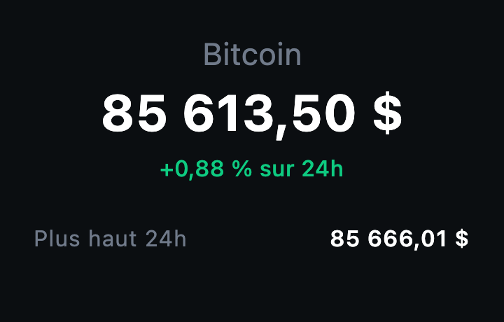

📏 Contraintes :

- Les deux valeurs viennent de l'API : regardez la réponse de Binance, elles y sont déjà.
- `Crypto` reste un modèle propre : des `Double`, pas des `String`.
- `FakeCryptoRepository` continue de fonctionner.

💡 Pistes : suivez la donnée dans l'ordre, du JSON jusqu'à l'écran. Quatre fichiers au moins sont concernés.

---

## 2. Trier la liste

🎯 L'utilisateur choisit l'ordre de la liste : par prix, par variation sur 24h ou par nom.

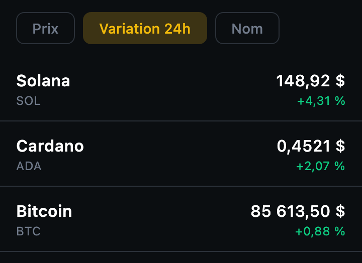

📏 Contraintes :

- Le tri est fait dans le **ViewModel**, pas dans le composable.
- Le tri choisi reste appliqué après un rafraîchissement.

💡 Pistes : une `enum class` pour les tris possibles ; `sortedBy` et `sortedByDescending` ; pour le choix, des [chips](https://developer.android.com/develop/ui/compose/components/chip) ou un [menu](https://developer.android.com/develop/ui/compose/components/menu).

---

## 3. Rechercher une crypto

🎯 Un champ de texte au-dessus de la liste filtre les cryptos par nom ou par symbole, sans tenir compte des majuscules.

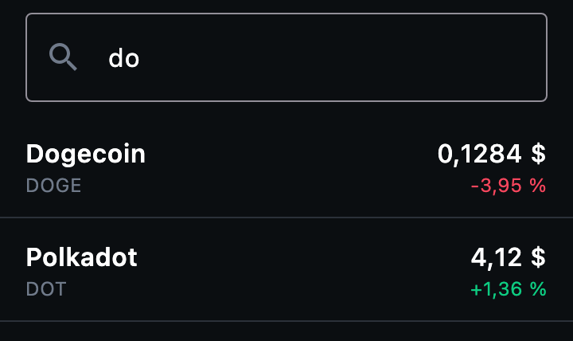

📏 Contraintes :

- Le texte saisi et le filtrage sont dans le **ViewModel**.
- Si aucune crypto ne correspond, l'écran le dit au lieu d'afficher une liste vide.

💡 Pistes : [les champs de texte](https://developer.android.com/develop/ui/compose/text/user-input) ; `filter` et `contains(..., ignoreCase = true)`. Où garder la liste complète pendant qu'on affiche la liste filtrée ?

---

## 4. Suivre d'autres cryptos

🎯 La liste contient au moins quinze cryptos.

📏 Contraintes :

- Aucune modification dans `ui`.
- Chaque crypto ajoutée a son vrai nom.

💡 Pistes : cherchez les paires disponibles sur [binance.com](https://www.binance.com/fr/markets/overview). Que se passe-t-il si vous demandez une paire qui n'existe pas ? Comment l'application réagit-elle ?

---

## 5. Choisir le thème clair ou sombre

🎯 Un bouton dans la barre de titre bascule entre le thème clair et le thème sombre, quel que soit le réglage du téléphone.

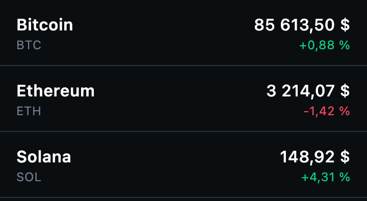 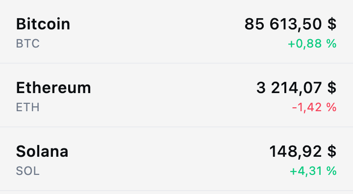

📏 Contraintes :

- Le choix s'applique aux **deux** écrans.
- Au premier lancement, l'application suit le réglage du système.

💡 Pistes : regardez la signature de `FollowMyCryptoTheme`. Où doit vivre l'état « thème choisi » pour que toute l'application le voie ? C'est une question de hissage d'état, comme au TP 1.

---

## 6. Créer votre propre thème

🎯 L'application a sa propre identité visuelle : une palette de couleurs **et** une typographie différentes de celles fournies.

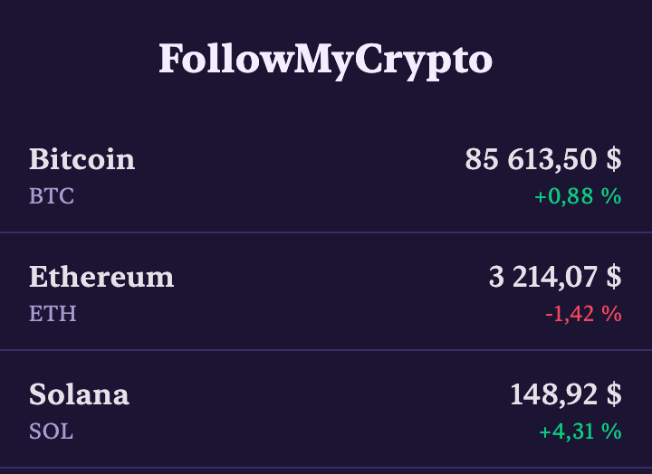

📏 Contraintes :

- Les couleurs et la typographie sont définies **dans le thème** (`theme/`), pas texte par texte dans les écrans. Si vous avez respecté les styles du thème au TP 2, vous n'avez presque rien à changer dans `ui`.
- Le thème clair et le thème sombre sont tous les deux cohérents et lisibles.
- La police est une vraie police, ajoutée aux ressources du projet.
- Le vert et le rouge des variations restent lisibles sur vos nouveaux fonds.

💡 Pistes : [le thème Material 3](https://developer.android.com/develop/ui/compose/designsystems/material3), dont `Typography` ; le [Material Theme Builder](https://material-foundation.github.io/material-theme-builder/) pour générer une palette ; [Google Fonts](https://fonts.google.com/) pour trouver une police, et [les polices dans les ressources Compose Multiplatform](https://kotlinlang.org/docs/multiplatform/compose-multiplatform-resources-usage.html) pour la charger.

---

## 7. Afficher les logos

🎯 Chaque ligne de la liste, et l'écran de détail, affichent le logo de la crypto.

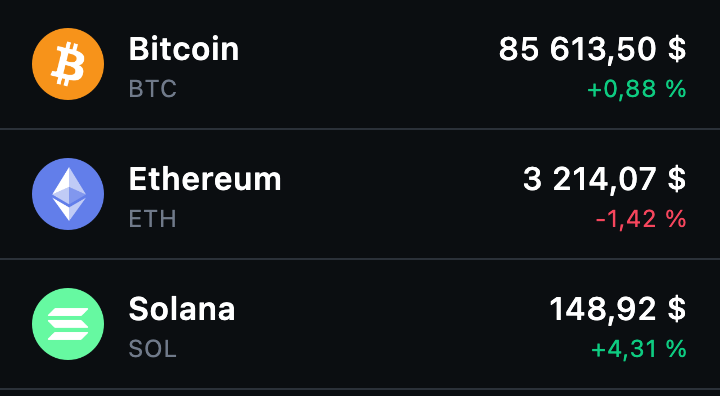

📦 Fourni : les logos sont disponibles à l'adresse suivante, avec le symbole en minuscules.

```
https://cdn.jsdelivr.net/gh/spothq/cryptocurrency-icons@master/128/color/btc.png
```

Pour charger une image depuis Internet, utilisez la bibliothèque **Coil**. Versions testées pour ce projet :

| Coordonnées | Version |
|---|---|
| `io.coil-kt.coil3:coil-compose` | 3.6.3 |
| `io.coil-kt.coil3:coil-network-ktor3` | 3.6.3 |

📏 Contraintes :

- Les bibliothèques sont déclarées dans le catalogue de versions, comme à l'étape 8 du TP 2.
- Tant que l'image n'est pas chargée, ou si elle n'existe pas, la ligne affiche autre chose qu'un trou : les initiales, par exemple.

💡 Pistes : [Coil et Compose](https://coil-kt.github.io/coil/compose/), [Coil et le réseau](https://coil-kt.github.io/coil/network/). Qui doit construire l'adresse du logo : le composable, ou le modèle ?

---

## 8. Un squelette de chargement

🎯 Pendant le chargement, l'écran n'affiche plus un indicateur qui tourne mais un **squelette** : des lignes grises à la place des cryptos, parcourues par un reflet animé (effet *shimmer*).

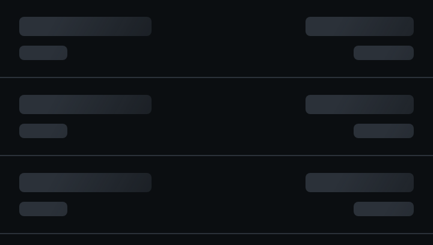

📏 Contraintes :

- Le squelette a la même forme que la vraie liste : même hauteur de ligne, des blocs à la place des textes.
- L'animation tourne en boucle tant que dure le chargement.
- Aucune bibliothèque supplémentaire.
- **Pour la démonstration**, prévoyez de quoi montrer le squelette : le réseau répond trop vite pour qu'on ait le temps de le voir. Par exemple un `delay(5_000)` écrit en dur dans le repository, juste avant l'appel à l'API.

💡 Pistes : `rememberInfiniteTransition`, dans [les animations basées sur une valeur](https://developer.android.com/develop/ui/compose/animation/value-based) ; un dégradé qui se déplace, avec [`Brush`](https://developer.android.com/develop/ui/compose/graphics/draw/brush). Commencez par un squelette immobile, puis animez-le. `FakeCryptoRepository` et son `delay` sont parfaits pour l'observer longtemps.

---

## 9. Faire clignoter le prix qui change

À faire avec l'évolution 10 ou 11. Avec le seul bouton « Rafraîchir », la liste est remplacée par l'écran de chargement à chaque fois : la ligne est recréée, elle ne se souvient plus de l'ancien prix et rien ne clignote. Prenez donc au moins l'une des deux pour pouvoir faire la démonstration.

🎯 Quand le prix d'une crypto change après un rafraîchissement, il clignote brièvement : en vert s'il a monté, en rouge s'il a baissé.

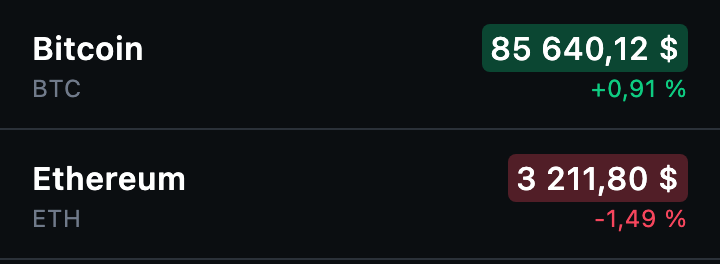

📏 Contraintes :

- C'est le composable qui compare le nouveau prix à l'ancien : rien à ajouter au ViewModel.
- Un prix inchangé ne clignote pas, et rien ne clignote au premier affichage.

💡 Pistes : `remember` pour garder le prix précédent, `LaunchedEffect(price)` pour réagir au changement, `animateColorAsState` pour la transition. Voir [le guide des animations](https://developer.android.com/develop/ui/compose/animation/quick-guide).

---

## 10. Rafraîchir en tirant la liste

🎯 Tirer la liste vers le bas la rafraîchit. Pendant le rafraîchissement, **la liste reste affichée** avec l'indicateur au-dessus : elle n'est pas remplacée par l'écran de chargement.

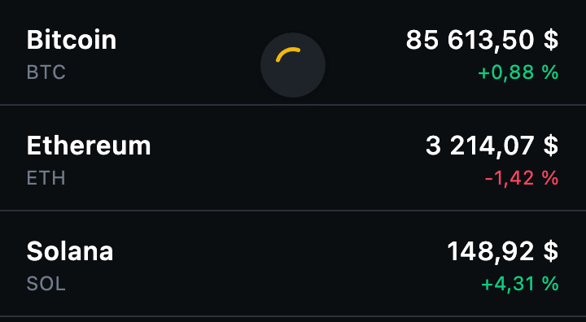

📏 Contraintes :

- Le premier chargement garde son écran de chargement plein écran.
- L'état de l'interface doit pouvoir dire « j'ai des données **et** je suis en train de rafraîchir ».

💡 Pistes : [Pull to refresh](https://developer.android.com/develop/ui/compose/components/pull-to-refresh). C'est surtout un travail sur `CryptoListUiState` : que faut-il lui ajouter ?

---

## 11. Rafraîchir automatiquement

🎯 Les prix se mettent à jour tout seuls toutes les dix secondes, sans que l'écran clignote.

📏 Contraintes :

- Le rafraîchissement s'arrête quand on quitte l'écran.
- Si un rafraîchissement automatique échoue, la liste déjà affichée reste à l'écran.

💡 Pistes : une boucle et `delay` dans une coroutine du `viewModelScope`. Relisez la note « Pour aller plus loin » de l'[étape 6 du TP 2](../tp2/06-repository-et-etats.md) : c'est ici qu'elle devient utile. Voir aussi [l'annulation des coroutines](https://kotlinlang.org/docs/cancellation-and-timeouts.html).

---

## 12. Les favoris

🎯 Un bouton sur chaque ligne (un cœur, une étoile…) ajoute ou retire la crypto des favoris. Un filtre n'affiche que les favoris. Le bouton est aussi présent, et à jour, sur l'écran de détail.

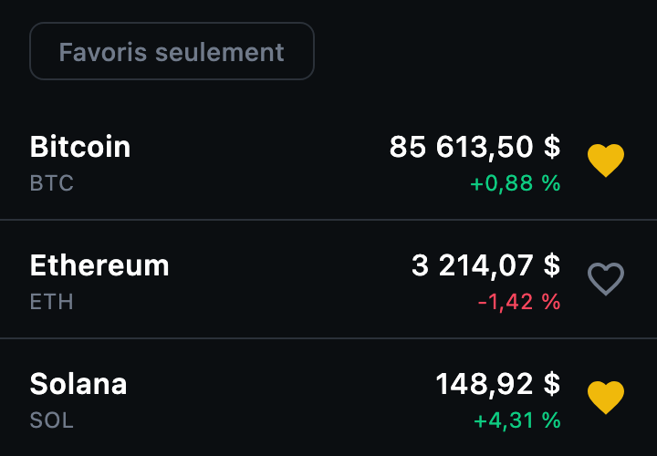

📏 Contraintes :

- Les favoris sont gérés par un **nouveau repository**, partagé par les deux écrans via `AppContainer`.
- Il expose les favoris dans un `StateFlow` : quand on change un favori dans le détail, la liste est à jour au retour.
- Les favoris peuvent être perdus à la fermeture de l'application (voir l'évolution 16).

💡 Pistes : un `Set<String>` de symboles suffit. Pour fabriquer un état à partir de **deux** flows (les cryptos et les favoris), regardez `combine` dans [la documentation des flows](https://kotlinlang.org/docs/flow.html). Les icônes `Favorite` et `FavoriteBorder` sont déjà dans le projet. Les [boutons icônes](https://developer.android.com/develop/ui/compose/components/icon-button).

---

## 13. Un convertisseur

🎯 L'écran de détail contient une petite calculatrice. L'utilisateur saisit une quantité de crypto (« 0,5 BTC ») et lit sa valeur en dollars. Il peut aussi faire l'inverse : saisir un montant en dollars et lire la quantité de crypto correspondante.

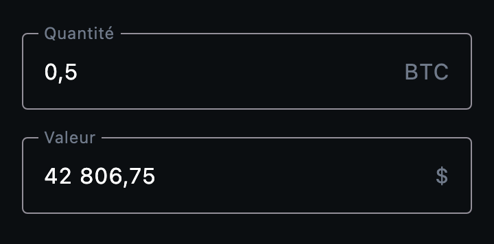

📏 Contraintes :

- Le calcul utilise le prix affiché à l'écran : quand le prix est rafraîchi, le résultat suit.
- Les deux champs sont liés : modifier l'un met à jour l'autre.
- Une saisie invalide (champ vide, lettres, virgule ou point) ne fait pas planter l'application.
- Le texte saisi et le calcul sont dans le **ViewModel**, pas dans le composable.
- Le clavier affiché sur téléphone est un clavier numérique.

💡 Pistes : [les champs de texte](https://developer.android.com/develop/ui/compose/text/user-input) et leur `keyboardOptions` ; `toDoubleOrNull` pour lire un nombre sans risque. Quel champ a été modifié en dernier ? C'est lui qui fait foi.

Pour aller plus loin : afficher aussi la valeur en **euros**. Binance fournit le prix en euros avec les paires `BTCEUR`, `ETHEUR`… : quelles couches faut-il modifier pour l'obtenir ?

---

## 14. Changer de devise

🎯 L'utilisateur choisit d'afficher les prix en dollars ou en euros.

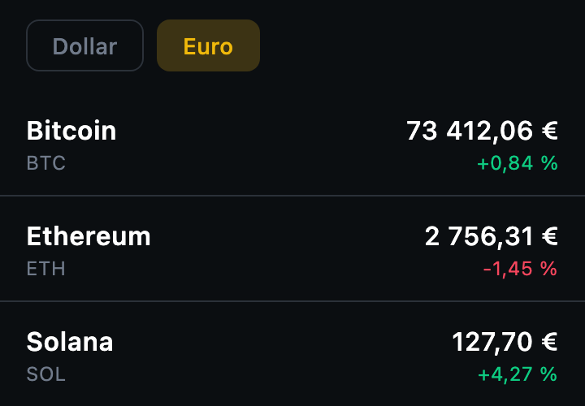

📏 Contraintes :

- Les prix en euros viennent de Binance : les paires `BTCEUR`, `ETHEUR`… existent. On ne convertit pas soi-même.
- Le symbole affiché à côté du prix suit la devise choisie.
- La devise choisie est connue du ViewModel, pas seulement du composable.

💡 Pistes : quelles couches connaissent aujourd'hui « USDT » ? Le contrat du repository doit-il changer ? Et `formatPrice` ?

---

## 15. Des messages d'erreur précis

🎯 L'écran d'erreur ne dit plus toujours « Impossible de charger les cours » : il distingue au moins l'absence de connexion, une erreur de notre côté (4xx) et une erreur du serveur (5xx).

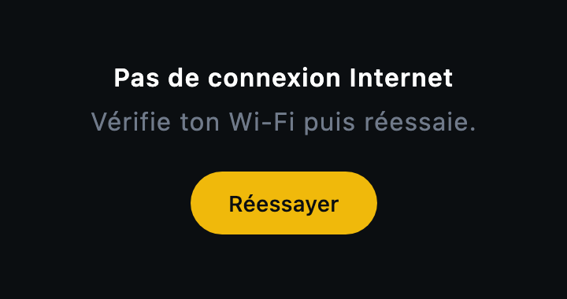

📦 Fourni : ce que Ktor lève. Notre client est configuré avec `expectSuccess = true` : d'après [la validation par défaut de Ktor](https://ktor.io/docs/client-response-validation.html#default), toute réponse dont le code n'est pas un succès (2xx) lève alors une exception.

| Situation | Exception |
|---|---|
| Réponse 3xx | `RedirectResponseException` |
| Réponse 4xx (mauvaise requête, paire inconnue…) | `ClientRequestException` |
| Réponse 5xx (le serveur est en panne) | `ServerResponseException` |
| Pas de connexion | `IOException` (celle de `kotlinx.io`) |

Les trois premières héritent de `ResponseException`, et donnent accès au code avec `e.response.status`.

📦 Fourni aussi : de quoi **simuler** chaque erreur. On ne peut pas créer soi-même une `ServerResponseException` (il lui faut une vraie réponse) : on demande donc à un serveur de test de répondre avec le code voulu, et c'est Ktor qui lève l'exception. Collez ces lignes au début de `BinanceApi.getTickers` et décommentez-en **une** à la fois :

```kotlin
// Pour simuler une erreur, décommente UNE de ces lignes :
// throw IOException("Pas de connexion")              // pas de réseau
// client.get("https://httpbin.org/status/404")       // 4xx → ClientRequestException
// client.get("https://httpbin.org/status/500")       // 5xx → ServerResponseException
```

Avec l'import `kotlinx.io.IOException`. Vous pouvez aussi couper le Wi-Fi, ou demander à Binance une paire qui n'existe pas (réponse 400).

📏 Contraintes :

- Le ViewModel ne connaît pas Ktor : c'est le repository qui traduit les exceptions techniques en erreurs que l'application comprend.
- L'interface choisit le message à partir du **type** d'erreur, pas d'un texte venu du repository.
- **Pour la démonstration**, gardez les lignes de simulation en commentaire dans le code : vous montrerez chaque message en en décommentant une.

💡 Pistes : une `sealed interface` peut décrire vos erreurs, comme elle décrit déjà l'état de l'écran. Dans le repository, un `try` / `catch` par type d'exception ; attention à l'ordre des `catch`.

---

## 16. Garder les favoris après fermeture

Nécessite l'évolution 12.

🎯 Les favoris sont toujours là quand on relance l'application, sur Android comme sur Desktop.

📦 Fourni : la bibliothèque **Multiplatform Settings**, version testée pour ce projet.

| Coordonnées | Version |
|---|---|
| `com.russhwolf:multiplatform-settings-no-arg` | 1.3.0 |

📏 Contraintes :

- Seul le repository des favoris change. Ni les ViewModels ni les composables ne savent où les favoris sont stockés.

💡 Pistes : [Multiplatform Settings](https://github.com/russhwolf/multiplatform-settings). Elle ne stocke que des valeurs simples : comment enregistrer un ensemble de symboles dans une seule `String` ?

---

## 17. Le graphique du prix

🎯 L'écran de détail affiche la courbe du prix sur les dernières 24 heures.

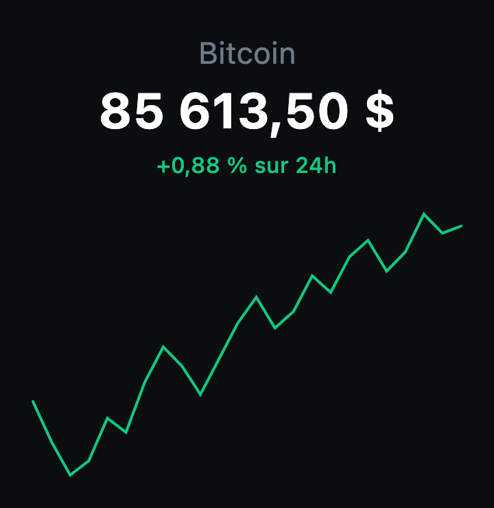

Le dessin de la courbe est **fourni** : le travail de cette évolution est d'aller chercher les données et de les amener jusqu'à l'écran, à travers toutes les couches.

📦 Fourni : l'API des « bougies » de Binance. Ouvrez-la dans le navigateur avant de coder.

```
https://data-api.binance.vision/api/v3/klines?symbol=BTCUSDT&interval=1h&limit=24
```

Chaque élément est un **tableau** : l'heure d'ouverture en millisecondes, puis les prix d'ouverture, le plus haut, le plus bas et de clôture, sous forme de texte.

📦 Fourni aussi : le composable qui trace la courbe, à créer dans `ui/detail/PriceChart.kt`. Il reçoit la liste des prix, du plus ancien au plus récent.

<details>
<summary>📄 <code>ui/detail/PriceChart.kt</code></summary>

```kotlin
package com.bvic.followmycrypto.ui.detail

import androidx.compose.foundation.Canvas
import androidx.compose.foundation.layout.fillMaxWidth
import androidx.compose.foundation.layout.height
import androidx.compose.runtime.Composable
import androidx.compose.ui.Modifier
import androidx.compose.ui.graphics.Path
import androidx.compose.ui.graphics.StrokeCap
import androidx.compose.ui.graphics.StrokeJoin
import androidx.compose.ui.graphics.drawscope.Stroke
import androidx.compose.ui.tooling.preview.Preview
import androidx.compose.ui.unit.dp
import com.bvic.followmycrypto.theme.FollowMyCryptoTheme
import com.bvic.followmycrypto.theme.PriceDown
import com.bvic.followmycrypto.theme.PriceUp

// Trace la courbe d'une suite de prix, du plus ancien au plus récent
@Composable
fun PriceChart(prices: List<Double>, modifier: Modifier = Modifier) {
    if (prices.size < 2) return

    val color = if (prices.last() >= prices.first()) PriceUp else PriceDown
    val min = prices.min()
    val max = prices.max()
    // Évite une division par zéro si tous les prix sont identiques
    val range = if (max > min) max - min else 1.0

    Canvas(modifier = modifier.fillMaxWidth().height(200.dp)) {
        val stepX = size.width / (prices.size - 1)
        val path = Path()
        prices.forEachIndexed { index, price ->
            val x = index * stepX
            // Le prix le plus haut est en haut : dans un Canvas, y = 0 est le bord supérieur
            val y = size.height - ((price - min) / range).toFloat() * size.height
            if (index == 0) path.moveTo(x, y) else path.lineTo(x, y)
        }
        drawPath(
            path = path,
            color = color,
            style = Stroke(width = 2.dp.toPx(), cap = StrokeCap.Round, join = StrokeJoin.Round),
        )
    }
}

@Preview(showBackground = true)
@Composable
fun PriceChartPreview() {
    FollowMyCryptoTheme {
        PriceChart(prices = listOf(100.0, 104.0, 101.0, 108.0, 106.0, 112.0))
    }
}
```

</details>

📏 Contraintes :

- Une nouvelle fonction dans `BinanceApi`, et une nouvelle fonction dans le contrat du repository, qui renvoie les prix de clôture.
- Le graphique a ses propres états de chargement et d'erreur : s'il échoue, le reste de l'écran de détail s'affiche quand même.
- `FakeCryptoRepository` continue de fonctionner.

💡 Pistes : la réponse n'est pas une liste d'objets, donc pas de `data class` pour le DTO : regardez `JsonArray` dans kotlinx.serialization, et comment lire son cinquième élément. Commencez par afficher la courbe avec une liste de prix écrite à la main, puis branchez les vraies données.

Pour aller plus loin : un choix de période (24 heures, 7 jours, 1 mois), ou votre propre version du dessin avec [`Canvas`](https://developer.android.com/develop/ui/compose/graphics/draw/overview).

---

## 18. Tester le ViewModel

🎯 Des tests automatiques vérifient le comportement de `CryptoListViewModel` : il démarre en chargement, passe en succès quand le repository répond, et en erreur quand il échoue.

📦 Fourni : la bibliothèque de test des coroutines, à ajouter aux dépendances de `commonTest`. Elle a la même version que les coroutines du projet.

```
org.jetbrains.kotlinx:kotlinx-coroutines-test
```

📏 Contraintes :

- Les tests sont dans `shared/src/commonTest` et passent avec `./gradlew :shared:jvmTest`.
- Aucun appel réseau : les tests utilisent un faux repository.
- Un test ne dure pas 1,5 seconde, malgré le `delay` du faux repository.

💡 Pistes : [tester les coroutines](https://developer.android.com/kotlin/coroutines/test) ; `runTest`, `Dispatchers.setMain` et `advanceUntilIdle` dans [kotlinx-coroutines-test](https://kotlinlang.org/api/kotlinx.coroutines/kotlinx-coroutines-test/). Vous voyez maintenant pourquoi le ViewModel **reçoit** son repository : pour le cas d'erreur, écrivez un faux repository qui échoue.

---

## 19. Tester l'interface

🎯 Des tests automatiques affichent l'écran liste, cliquent dessus et vérifient ce qui se passe, sans lancer l'application à la main :

- en état de succès, les cryptos sont affichées, et un clic sur une ligne remonte le bon symbole ;
- en état d'erreur, le message est affiché, et un clic sur « Réessayer » déclenche le rechargement ;
- en état de chargement, la liste n'est pas affichée.

📦 Fourni : la bibliothèque de test de Compose Multiplatform. Elle a la même version que Compose Multiplatform dans le catalogue.

```
org.jetbrains.compose.ui:ui-test
```

Dans `shared/build.gradle.kts`, il faut aussi donner aux tests Desktop de quoi dessiner l'interface :

```kotlin
commonTest.dependencies {
    // ... kotlin-test, déjà présent
    implementation(libs.compose.uiTest) // le nom que vous lui aurez donné dans le catalogue
}
jvmTest.dependencies {
    implementation(compose.desktop.currentOs)
}
```

La fonction qui lance un test est `runComposeUiTest`. Prenez celle du package `androidx.compose.ui.test.v2`, avec l'annotation `@OptIn(ExperimentalTestApi::class)` sur la classe de test.

📏 Contraintes :

- Les tests sont dans `shared/src/commonTest` et passent avec `./gradlew :shared:jvmTest`.
- Ils portent sur `CryptoListContent`, pas sur `App()` : aucun réseau, aucun ViewModel.
- Au moins un test par état de l'écran.

💡 Pistes : [tester une interface Compose Multiplatform](https://kotlinlang.org/docs/multiplatform/compose-test.html), et [les API de test de Compose](https://developer.android.com/develop/ui/compose/testing/apis) : `setContent`, `onNodeWithText`, `performClick`, `assertIsDisplayed`, `assertDoesNotExist`. Pour vérifier qu'un clic a bien eu lieu, passez un callback qui note ce qu'il reçoit dans une variable. Vous voyez maintenant l'intérêt d'avoir séparé `CryptoListScreen` et `CryptoListContent`.

---

## 20. Votre idée

Une alerte quand un prix dépasse un seuil, un portefeuille fictif, un classement des plus fortes hausses… Si vous avez une idée qui n'est pas dans la liste, faites-la : sa difficulté sera estimée pendant la démonstration.

---

[⬅️ Sommaire](README.md) · [L'évaluation ➡️](02-evaluation.md)
